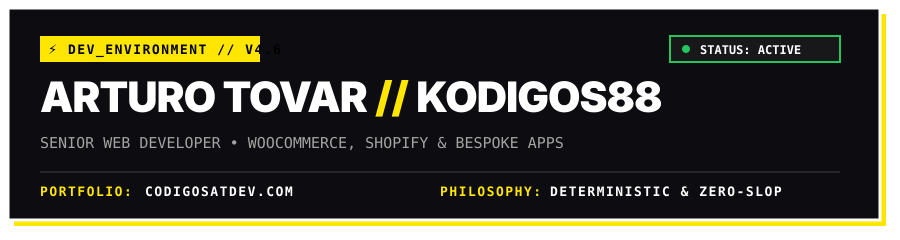

<div align="center">
  
</div>

<br/>

```yaml
# ─── SYS.PROFILE_MANIFEST ──────────────────────────────────────────────────
developer: "Arturo Tovar (Arthur)"
handle: "@kodigos88"
role: "Senior Web Developer & Bespoke App Architect"
portfolio: "https://codigosatdev.com"
specialties:
  - "High-performance WordPress, WooCommerce & Shopify Engineering"
  - "Custom Theme & Plugin Development (PHP, Liquid, Zero-bloat)"
  - "Modern Full-Stack Apps (Astro v5, Next.js, PWAs)"
  - "Deterministic Agentic Workflows & Linux Automation"
motto: "Fast code, bulletproof architecture, zero slop."
# ───────────────────────────────────────────────────────────────────────────
```

<br/>

## ⚡ TECH STACK // ARSENAL

### 🛠️ Core Languages & Backend
<p align="left">
  
  
  
  
  
  
</p>

### 🌐 CMS, E-Commerce & Web Architecture
<p align="left">
  
  
  
  
  
  
  
</p>

### 🎨 Modern Frontend & Motion
<p align="left">
  
  
  
  
  
</p>

### ⚙️ DevOps, OS & Cloud
<p align="left">
  
  
  
  
</p>

<br/>

## 📂 FEATURED PROJECTS // VITRINA

| PROJECT | STACK / ARCHITECTURE | DISPATCH |
| :--- | :--- | :---: |
| **🌐 Portfolio Oficial** | Jamstack, Ultra-fast Performance & Modern UX | [**VISIT SITE →**](https://codigosatdev.com) |
| **🛰️ TeleOps Bridge** | Lightweight Webhook & Microservice Bridge for Ops | [**VIEW REPO →**](https://github.com/kodigos88/tele-ops-bridge) |
| **🧬 Genética App** | PWA Zootécnica para control reproductivo y consanguinidad | `PRIVATE CORE` |
| **✨ Chrome Glow** | Aesthetic UI/UX Extension & Custom Styling Engine | `PRIVATE CORE` |

<br/>

## 📊 TELEMETRY & STATS

<div align="center">
  <a href="https://github.com/kodigos88">
    
  </a>
  <a href="https://github.com/kodigos88">
    
  </a>
</div>

<br/>

## 📬 DISPATCH // LET'S TALK BUSINESS

<p align="center">
  <a href="https://codigosatdev.com" target="_blank">
    
  </a>
  &nbsp;
  <a href="mailto:kodigosat@gmail.com">
    
  </a>
  &nbsp;
  <a href="https://github.com/kodigos88">
    
  </a>
</p>

<br/>

<div align="center">
  <sub><code>ENGINEERED WITH RIGOR // ALL RIGHTS RESERVED © ARTURO TOVAR</code></sub>
</div>
